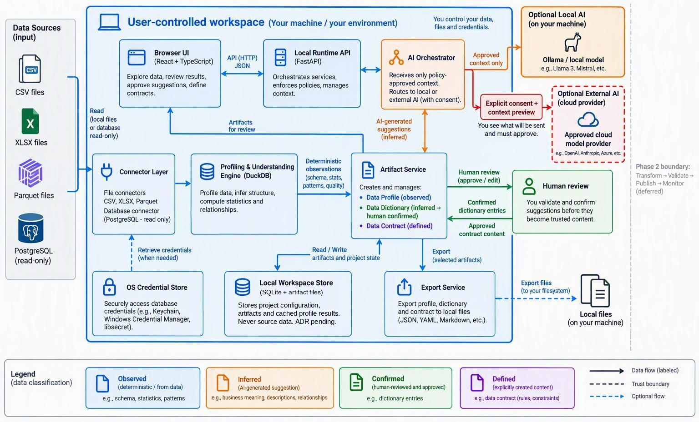
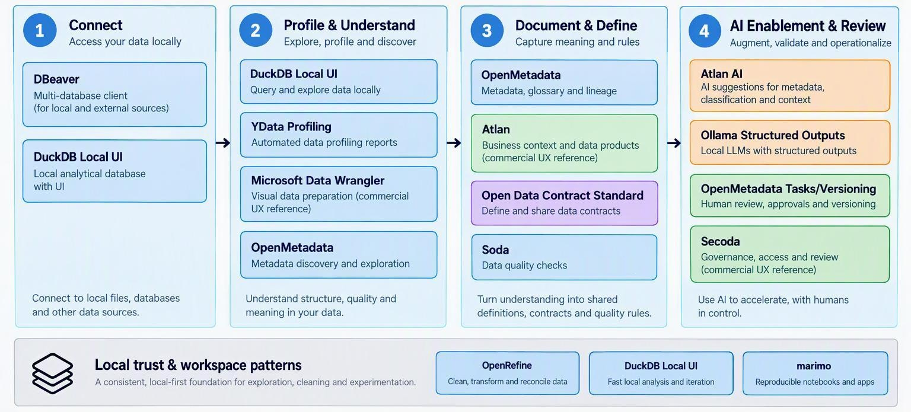

# DrivnX — Phase 1 Development Direction

*Consolidated Phase 1 direction — approved*

| Item | Detail |
|---|---|
| Product | DrivnX (the product and the company); built by the Trison Labs team |
| Status | Approved after team review (findings: [DrivnX_Phase1_Review_Notes.md](DrivnX_Phase1_Review_Notes.md)) |
| Date | 20 October 2026 |
| Prepared by | Huynh Nguyen |
| Phase 1 scope | Connect → Profile & Understand → Document & Define, with AI Enablement across all steps |
| Deferred to Phase 2 | Transform → Validate → Publish & Serve → Monitor & Improve |
| Consolidated from | Phase 1 Development Direction; Existing Product & UI Reference; Phase 1 Development Guide (phase1_next) |

> **How to read this document**
>
> - **5-minute read:** Section 1 (At a glance) gives the whole direction on one page.
> - **Product & design reviewers:** focus on Sections 2, 3, 8 and 9.
> - **Engineering reviewers:** focus on Sections 4, 5, 6, 7 and 10, then use Section 12 to start development.
> - **Everyone:** Section 11 lists the open decisions and the review checklist we need sign-off on.

## What is inside

| # | Section | In one line |
|---|---|---|
| 1 | [At a glance](#1-at-a-glance) | Goal, four key decisions, scope boundary, principles |
| 2 | [What Phase 1 delivers](#2-what-phase-1-delivers) | User journey, example overview, definition of done |
| 3 | [Core product model](#3-core-product-model) | Profile / Dictionary / Contract and the four trust states |
| 4 | [Architecture and technology](#4-architecture-and-technology) | Diagram, components, stack, what we avoid |
| 5 | [Data sources and profiling](#5-data-sources-and-profiling) | Connectors, progressive profiling, findings |
| 6 | [AI enablement](#6-ai-enablement) | Modes, what AI may see, consent flow, UX |
| 7 | [Security and client trust](#7-security-and-client-trust-baseline) | Must-have controls, threats, safe claims |
| 8 | [Phase 1 web UI](#8-phase-1-web-ui) | App shell and seven essential screens |
| 9 | [Reference products](#9-reference-products-to-study) | What to study, borrow, avoid |
| 10 | [Delivery plan](#10-delivery-plan) | Milestones, spikes, testing, repo layout |
| 11 | [Risks, decisions, sign-off](#11-risks-open-decisions-and-review-checklist) | Assumptions, open ADRs, inconsistencies, checklist |
| 12 | [Engineering kickoff](#12-engineering-kickoff--start-here) | First slice, setup, domain model, interfaces, UI structure, API outline |

---

## 1. At a glance

### Phase 1 goal

> Help a user connect unfamiliar data and quickly turn it into **evidence-backed, human-reviewed understanding** and **explicit data definitions**.

### Four key decisions

| Decision | Direction |
|---|---|
| **Architecture** | Local Python runtime + browser UI. Deterministic profiling and artifacts stay on the user's machine by default. |
| **First database connector** | PostgreSQL, read-only, using the same DuckDB-based analysis path as local files (CSV, XLSX, Parquet). |
| **AI direction** | Provider-neutral hybrid layer. External AI is the quality path, local Ollama is the privacy/offline option, and external sending always needs explicit consent. |
| **Security posture** | Minimum credible controls, not enterprise hardening: localhost-only API, OS credential storage, least-data AI context, visible provenance. |

### Scope boundary

| In Phase 1 (build now) | Not in Phase 1 (Phase 2 or later) |
|---|---|
| Connect CSV, XLSX, Parquet and PostgreSQL (read-only) | Transformation builders and pipeline execution |
| Deterministic profiling with sample/full labels | Contract validation against outputs |
| Executive summary and prioritised findings | Scheduling, retries, backfills |
| Data Dictionary with human review | Publishing or serving APIs |
| Basic Data Contract + YAML/JSON export | Continuous monitoring |
| Optional AI suggestions with review | Multi-user collaboration, enterprise catalog integration |
| Local persistence and provenance | Automatic remediation or autonomous AI actions |

### North star principles

| Principle | What it means in practice |
|---|---|
| Evidence before inference | Every conclusion traces back to a measured observation. |
| Suggestions require review | AI output is never treated as truth until a person confirms it. |
| Egress must be explicit | Users always see what leaves their machine before it is sent. |
| Understanding over metadata | Help users understand their data — not just show them more statistics. |

---

## 2. What Phase 1 delivers

### The user journey

| Step | What the user does | What DrivnX provides |
|---|---|---|
| 1. Create workspace | Chooses the location when starting DrivnX (a default is used if none is given), then names the workspace and picks its AI mode (off / external / local) in the browser. | Clear statement of where artifacts and credentials are stored. |
| 2. Connect | Selects files, schemas or tables to analyse. | CSV, XLSX, Parquet; PostgreSQL read-only. Shows whether data is read in place or queried remotely. |
| 3. Profile | Chooses scope and profiling depth. | Schema, types, completeness, uniqueness, distributions, patterns, candidate keys and relationships — each labelled exact, approximate, sampled or metadata-derived. |
| 4. Understand | Reads the executive overview. | Prioritised findings, documentation gaps and recommended next actions, linked to evidence. |
| 5. Document | Reviews draft descriptions and definitions. | Accept, Edit, Reject or Defer — with evidence and provenance kept. |
| 6. Define & export | Promotes confirmed knowledge into rules. | Basic contract rules; export of Profile, Dictionary and Contract. |

### Example: what the executive overview should feel like

> **Customer Database — 12 tables · 184 columns · 2.4M rows**
>
> **Key findings:** 14 undocumented fields · 3 possible identifiers · 2 relationships need confirmation · 7 fields with significant missing values · unclear currency definition
>
> **Recommended actions:** Confirm `customer_id` · Review Customer → Order relationship · Document revenue fields · Investigate missing payment status · Define an Orders contract

### Definition of done

The prototype is complete when a user can:

| Area | User can… |
|---|---|
| Workspace | Create and reopen a local workspace with provenance intact. |
| Connect & profile | Connect CSV/XLSX/Parquet/PostgreSQL, select scope, run deterministic profiling, and tell sampled from full results. |
| Understand | See prioritised findings and an executive summary, and inspect the evidence behind them. |
| AI | Generate optional AI suggestions, see exactly what context is sent, and Accept/Edit/Reject/Defer them. |
| Document & define | Build a reviewed Data Dictionary and promote confirmed knowledge into Data Contract rules. |
| Export | Export Profile, Dictionary and Contract, traceable to their evidence and author. |

---

## 3. Core product model

### Three connected artifacts

The three artifacts are connected views over one knowledge model — not three separate documents. Conceptually: **Evidence → Meaning → Expectations**.

| Artifact | Question it answers | Contains | Mutability |
|---|---|---|---|
| **Data Profile** | What is actually there? | Schema, types, completeness, uniqueness, distributions, patterns, relationships, quality observations | Immutable snapshot per run |
| **Data Dictionary** | What does it mean? | Dataset/field descriptions, business definitions, examples, relationships, assumptions, limitations | Editable, versioned |
| **Data Contract** | What should be true? | Dataset purpose and limitations; required, type, unique, accepted values, range, identifier, relationship rules | Editable, versioned, exportable |

### Trust model: Observed → Inferred → Confirmed → Defined

| State | Created by | Example | UI colour |
|---|---|---|---|
| **Observed** | Deterministic profiling | `customer_id` is 99.8% unique | Blue |
| **Inferred** | AI or heuristic | This may identify a customer | Orange / amber |
| **Confirmed** | A person | This is the customer identifier | Green |
| **Defined** | A person, via the contract | It must be non-null and unique | Purple |

> **Hard rule**
>
> AI-generated content always starts as **Inferred**. Only a user can promote it to Confirmed or Defined. A user can also write content directly as Confirmed, so the product works with AI off. Confidence scores appear only on Inferred items, and every state badge opens its evidence and provenance. The full transition rules, including edits and demotion, are in [§12](#trust-state-rules-to-enforce-in-the-domain-layer).

---

## 4. Architecture and technology

Deterministic processing and artifact state stay local. External AI sits beside the main path as an explicit, visible trust boundary that is crossed only after the user approves the context.



*Figure 1 — Recommended Phase 1 architecture (local by default; AI is optional and consent-gated)*

<details>
<summary>Text description of Figure 1</summary>

- **Data sources (input):** CSV, XLSX, Parquet files and PostgreSQL (read-only) are read by the Connector Layer (local files or database read-only).
- **User-controlled workspace (your machine / your environment):**
  - Browser UI (React + TypeScript) ⇄ Local Runtime API (FastAPI) over HTTP/JSON.
  - Local Runtime API ⇄ AI Orchestrator.
  - Connector Layer → Profiling & Understanding Engine (DuckDB) → *deterministic observations* (schema, stats, patterns, quality) → Artifact Service.
  - Artifact Service creates and manages the Data Profile (observed), Data Dictionary (inferred → human confirmed) and Data Contract (defined), and sends artifacts for review to the Browser UI.
  - AI Orchestrator → *AI-generated suggestions (inferred)* → Artifact Service.
  - Artifact Service ⇄ Local Workspace Store (SQLite only — ADR 0002): read/write artifacts, project state and profile results. Source data is never copied into it.
  - OS Credential Store (Keychain, Windows Credential Manager, libsecret) → Connector Layer: retrieve credentials when needed.
  - Artifact Service → Export Service (selected artifacts) → local files (JSON, YAML, Markdown, etc.).
- **Human review:** Artifact Service → human review (approve / edit) → confirmed dictionary entries and approved contract content flow back.
- **Optional local AI (on your machine):** Ollama / local model (e.g. Llama 3, Mistral) receives approved context only.
- **Optional external AI (cloud provider), behind a trust boundary:** reached only via *explicit consent + context preview* ("You see what will be sent and must approve").
- **Phase 2 boundary (deferred):** Transform → Validate → Publish → Monitor.
- **Legend:** Observed (deterministic / from data), Inferred (AI-generated suggestion), Confirmed (human-reviewed and approved), Defined (explicitly created content, e.g. data contract rules and constraints). Solid arrow = data flow; dashed = trust boundary; dashed blue = optional flow.

</details>

### Component responsibilities

| Component | Responsibility |
|---|---|
| Browser UI | Exploration, review, editing, AI suggestions, export. Receives only paginated previews and artifacts. |
| Local runtime / API | Owns sessions, auth token, jobs and all access to files, credentials, DuckDB, SQLite and AI providers. Serves the UI bundle. |
| Connector layer | Common interface for files and PostgreSQL (test, discover, preview, profile). |
| Profiling engine | Deterministic observations and finding candidates. Never asserts business meaning as fact. |
| Artifact service | Profile, Dictionary, Contract, revisions, state transitions and provenance. |
| AI orchestrator | Provider-neutral structured requests; validates output; records everything as Inferred. |
| Workspace & credential stores | SQLite only (ADR 0002) for state and profile results, never copied source data; OS credential store for passwords and API keys. |
| Export service | JSON, YAML, Markdown and CSV artifacts. |

### Recommended technology stack

| Layer | Choice |
|---|---|
| Runtime | Python 3.12 |
| Local API | FastAPI + Uvicorn |
| Domain models | Pydantic v2 |
| Analytical engine | DuckDB |
| Workspace metadata | SQLite (+ SQLAlchemy Core / Alembic) |
| PostgreSQL access | DuckDB PostgreSQL extension (psycopg only if needed) |
| Tooling | uv (Python), pnpm (frontend), committed lockfiles |
| Frontend | React + TypeScript + Vite |
| UI components | Radix / shadcn-style |
| Tables / server state | TanStack Table / Query |
| Charts | Lightweight SVG / Recharts |
| Local AI | Ollama adapter |
| External AI | One provider SDK behind a small internal adapter |
| Testing | pytest, Vitest, Playwright; Docker Compose PostgreSQL fixture |

### Deliberately avoided in Phase 1

Workflow/AI orchestration frameworks (e.g. LangChain-style) · vector databases · distributed processing · microservices · Electron/Tauri packaging before the browser UX is validated · Pandas-centred profiling · enterprise IAM. **Prefer a modular monolith.**

---

## 5. Data sources and profiling

### Why PostgreSQL first

PostgreSQL gives the best implementation fit: DuckDB can attach it directly in read-only mode, so there is no second analytics path to build. SQL Server and MySQL are the next candidates, subject to user discovery. A SQLite connector does not count as a "real" first database because it behaves like another local file.

### Connector behaviour

| Source | Phase 1 behaviour |
|---|---|
| CSV | Delimiter, encoding and header detection; user can correct inferred types. |
| XLSX | Sheet and header/range selection, type inference, all-text fallback. `.xls` is not supported. |
| Parquet | Preserve native types; inspect metadata before scanning. |
| PostgreSQL | Read-only account; discover schemas, tables, views, columns, keys; user selects scope first; sample by default; full scans only on explicit request; cancellable with per-table limits. |

**Common rules:** files are referenced in place (never silently copied), and DrivnX never writes to a source in Phase 1.

### Progressive profiling

| Level | When | What it measures |
|---|---|---|
| 1. Metadata scan | Always — fast and cheap | Schemas, tables, columns, types, declared keys |
| 2. Fast profile | Default — sample-based | Completeness, cardinality, distributions, patterns, candidate identifiers and relationships |
| 3. Full profile | Explicit user action only | Exact results for selected tables; cancellable |

Every metric carries **scope, method, precision, sample size, timestamp and profile-run ID**, so sampled and exact results are never visually mixed. Declared relationships and candidate (inferred) relationships are stored separately.

*Note (2026-11-05): by the user's decision, a CSV's fast profile reads the first 100,000 rows, labelled "first rows, not random", because a random sample of a CSV still reads the whole file. Min, max, frequent values, distributions, mean, median and standard deviation are computed on request and not saved as observations, and masked patterns always come from the first 100,000 rows. Candidate relationships move to the M5 work, and correcting column types moves to the rest of M2. See `.ai/knowledge/requirements/CFX-APP-csv-profile.md` and [ADR 0004](../drivnx-web/docs/adr/0004-profile-values-and-caching.md) in drivnx-web.*

### From statistics to understanding

Profiling statistics are not the end product. Each important observation becomes a short, traceable finding:

| Observed | Inferred | Why it matters | Recommended action | Evidence |
|---|---|---|---|---|
| `customer_id` uniqueness = 99.8% | Possible customer identifier | May be the main business entity key | Confirm identifier meaning | Profile run #42 / `customer.customer_id` |

The executive summary has two layers: a **deterministic template** (counts, top findings, gaps, candidate relationships) and an **optional AI narrative**. Every statement links to its table, column and evidence. This layer is a key DrivnX differentiator.

---

## 6. AI enablement

AI should **accelerate understanding, not become the source of truth**. It can summarise datasets, explain findings, draft descriptions, suggest identifiers, relationships and contract rules, flag documentation gaps and recommend next actions.

### Three AI modes

| Mode | Role in Phase 1 | Trade-off |
|---|---|---|
| No AI | The full deterministic product remains usable. | No assistance |
| External AI | Primary quality path; one approved provider; off until explicitly enabled. | Approved context leaves the device; needs clear disclosure |
| Local AI (Ollama) | Privacy / offline option; experimental at first. | Quality depends on model and user hardware |

### What AI is allowed to see

| Sent by default (metadata only) | Needs separate consent |
|---|---|
| Table and column names, types | Raw sample rows |
| Profiling statistics | Literal / category values |
| Declared keys and relationship metadata | Free-text content |
| Confirmed definitions | Potentially sensitive or personal fields |
| User-entered dataset purpose | User notes containing customer information |

### External request flow

```
AI action → Build context → Apply policy → Show context preview → User approves
          → Provider → Validate structured output → Save as Inferred
```

The preview always shows: **Provider · Model · Context categories · Raw values included? · Send / Cancel**

### AI user experience

- **Suggestion-first, not chat-first:** contextual actions such as *Draft description*, *Explain finding*, *Suggest identifier*, *Suggest relationship*, *Suggest contract rule*.
- **Every suggestion supports:** Accept · Edit · Reject · Defer · View Evidence.
- **Structured outputs only:** all responses are schema-validated (Pydantic). Free-form AI text never enters the domain model directly.
- **Ollama is reached only via the local backend** — never exposed directly to the browser or network, as its local API has no authentication.
- A conversational assistant may come later as a secondary interface.

---

## 7. Security and client trust baseline

Phase 1 needs **credible foundations, not enterprise security infrastructure**. Trust should come from visible product behaviour, not broad marketing claims.

### Must-have controls

| Area | Controls |
|---|---|
| Local API | Bind to `127.0.0.1` only · serve UI and API from one origin · validate Host and Origin · per-launch session token on every `/api/*` call except `/api/session` |
| Credentials | OS credential store · never in SQLite, URLs, browser storage, logs or exports |
| Database | Read-only credentials · no writes · bounded queries · cancellation |
| AI | External AI off by default · context preview · extra approval for raw values · provider/model visible · requests recorded in provenance |
| Logging & telemetry | Never log credentials, connection strings, tokens, raw rows or sensitive AI context · telemetry off by default |
| Supply chain | Pinned dependencies and lockfiles · secret and dependency scanning in CI · one-page threat register |

### Simple threat model

| Threat | Phase 1 mitigation |
|---|---|
| Malicious web page calls the local API | Loopback binding, host/origin validation, session token |
| Database or API key leaks | OS keyring, masking, never logged or exported |
| Sensitive data sent to AI unintentionally | AI off by default, context preview, explicit approval, audit record |
| Workspace copied or stolen | Owner-only permissions, no credentials, raw data not copied by default |
| Huge or malformed input exhausts resources | Sampling, size warnings, limits, cancellation |
| AI produces incorrect documentation | Inferred state + human review |

*Note (2026-11-05): "raw data not copied by default" now has a rule for profiling. A profile saves only counts, percentages, text lengths and masked patterns, and values from the file are computed on request and never saved. Two things stay open: a row used as column names that the user never corrects, and dictionary examples and contract accepted values, which are due with those slices. See [ADR 0004](../drivnx-web/docs/adr/0004-profile-values-and-caching.md) in drivnx-web.*

### What we can and cannot claim

| Safe once implemented and tested | Avoid for now |
|---|---|
| Profiling and artifact storage run locally. | "Your data never leaves your device." |
| External AI is optional and requires explicit enablement. | "Zero retention." |
| Users can see what context is sent before an external AI request. | "Enterprise-grade security" / "Fully secure." |
| Credentials are stored using the OS credential store where supported. | SOC 2 / GDPR / HIPAA compliance claims. |
| | "Anonymous" or "fully encrypted." |

**Later enterprise hardening (not Phase 1):** signed installers, workspace encryption, SSO/RBAC, data classification, tamper-evident audit, approved AI data-residency/ZDR, DPA review, parser sandboxing, formal security assessment.

---

## 8. Phase 1 web UI

### Application shell

**Header:** Workspace | Profile status | AI mode | Privacy indicator | Export

| Left — Data Explorer | Centre — Understanding Workspace | Right — Intelligence & Review |
|---|---|---|
| Workspace → Source → Schema → Table → Column | Tabs: Overview · Profile · Dictionary · Contract | Findings · AI suggestions · Evidence · Provenance · Review actions |

### Seven essential screens

| # | Screen | Purpose |
|---|---|---|
| 1 | Workspace & Sources | Set up the workspace (name, AI mode) and connect data |
| 2 | Source Explorer | Navigate schemas, tables and columns |
| 3 | Executive Overview | Asset counts, documentation coverage, key findings, relationships, recommended actions |
| 4 | Table / Column Profile | Deterministic evidence with sample/full labels |
| 5 | Dictionary Review | Review and edit descriptions and definitions |
| 6 | Contract Editor | Promote confirmed knowledge into explicit rules (visual editor, not raw YAML) |
| 7 | Privacy, AI & Export | Control AI mode, review egress settings, export artifacts |

Findings, relationships and AI are embedded as tabs or drawers in these screens — **not built as separate apps or a standalone chat screen**.

---

## 9. Reference products to study

These are **patterns to study, not products to copy**. The goal is to combine their best ideas into a narrower, simpler Phase 1 experience with DrivnX's explicit trust-state model.



*Figure 2 — Reference landscape mapped to the Phase 1 workflow. Databricks and Palantir Foundry are secondary references, covered in [Lessons from enterprise platforms](#lessons-from-enterprise-platforms-databricks-and-palantir-foundry).*

<details>
<summary>Text description of Figure 2</summary>

1. **Connect** — *Access your data locally.* DBeaver (multi-database client for local and external sources); DuckDB Local UI (local analytical database with UI). *Connect to local files, databases and other data sources.*
2. **Profile & Understand** — *Explore, profile and discover.* DuckDB Local UI (query and explore data locally); YData Profiling (automated data profiling reports); Microsoft Data Wrangler (visual data preparation, commercial UX reference); OpenMetadata (metadata discovery and exploration). *Understand structure, quality and meaning in your data.*
3. **Document & Define** — *Capture meaning and rules.* OpenMetadata (metadata, glossary and lineage); Atlan (business context and data products, commercial UX reference); Open Data Contract Standard (define and share data contracts); Soda (data quality checks). *Turn understanding into shared definitions, contracts and quality rules.*
4. **AI Enablement & Review** — *Augment, validate and operationalize.* Atlan AI (AI suggestions for metadata, classification and context); Ollama Structured Outputs (local LLMs with structured outputs); OpenMetadata Tasks/Versioning (human review, approvals and versioning); Secoda (governance, access and review, commercial UX reference). *Use AI to accelerate, with humans in control.*
- **Local trust & workspace patterns** — *A consistent, local-first foundation for exploration, cleaning and experimentation:* OpenRefine (clean, transform and reconcile data); DuckDB Local UI (fast local analysis and iteration); marimo (reproducible notebooks and apps).

</details>

### Top 8 references

| Reference | Study for | Borrow | Avoid |
|---|---|---|---|
| OpenMetadata (OSS) | Asset profile, versioning, tasks, connected metadata | Connected context around one asset | Full enterprise catalog scope |
| DuckDB Local UI | Local runtime + browser architecture, source tree, column explorer | Fast table-to-understanding drill-down; explicit cloud opt-in | Query-first experience |
| Atlan AI (commercial) | AI documentation review | In-place generate / apply / edit / discard + activity stamp | Chat-first UX |
| YData Profiling (OSS) | Profiling vocabulary, alerts, missingness | Metric depth | Every metric with equal weight |
| DBeaver (OSS) | Source navigation, ER diagrams | Stable source hierarchy | DBA-level complexity |
| ODCS (open standard) | Portable contract schema | Export vocabulary (small subset) | Exposing the whole standard in the UI |
| Soda Core / Contracts | YAML contracts, visual/code parity, diffs | Bridge from definitions to executable rules | YAML-first authoring |
| OpenRefine (OSS) | Local browser workflow, reversible history | Human-controlled, local interaction model | Its dated UI |

**Secondary references:** dbt Catalog (lineage navigation, more relevant in Phase 2), Secoda (connected documentation), marimo (reactive local data apps), Microsoft Fabric Data Wrangler (grid + column summary + sampling controls), Databricks Catalog Explorer (AI comment review, asset overview) and Palantir Foundry (dataset page, object/link model).

### Lessons from enterprise platforms: Databricks and Palantir Foundry

**Take patterns, not architecture.** Both are enterprise platforms built around pipelines and governance. Only practical, Phase 1-sized items are proposed; each row says when it applies.

| Pattern seen | Source | Proposal for DrivnX | When |
|---|---|---|---|
| AI description generated per object, on request; user accepts or edits before saving | Databricks | Keep AI per-item and user-triggered; no automatic bulk generation after profiling | Phase 1 (M8) |
| Vendor advises not relying on AI to detect personal data | Databricks | Make sensitive-field detection rule-based (names/patterns), not AI | Phase 1 (M3); decided |
| Saving a comment alters the source table and can disrupt jobs | Databricks | Confirms our rule: documentation stays in the DrivnX workspace, never written to the source | Already in scope |
| Recents and Favorites for quick return to assets | Databricks | Add Recent / Pinned tables to the Data Explorer | Phase 1 nice-to-have (M2) |
| Dataset page: About panel, column stats, Preview and History tabs | Foundry | Use as layout model for the Table / Column Profile screen; History = previous profile runs | Phase 1 (M3) |
| Fix CSV parsing (encoding, malformed rows) on the dataset page | Foundry | Let users correct CSV parsing in place, then re-profile | Phase 1 (M2) |
| AI changes staged as proposals for human review | Foundry AIP | Confirms the review inbox; consider "Proposal" as UI wording | Phase 1 (M8) |
| Ontology: business objects with keys and typed links | Foundry | Spike a simple "Confirmed entities" view (e.g. Customer → Order) built only from Confirmed items | Spike only |
| Health checks; datasets coloured by health on lineage | Foundry | Revisit when contracts become executable checks | Phase 2 |
| Pipelines, lineage graphs, AI agents, automated actions | Both | Out of scope; conflicts with read-only, human-in-control Phase 1 | Avoid |

### Where DrivnX should differentiate

| Capability | DrivnX opportunity |
|---|---|
| Connect | Guided source intake: connect → confirm read-only → choose scope → choose profiling mode → review access → run |
| Profile | Executive understanding instead of metric overload |
| Relationships | Clear split between declared and inferred; focused neighbourhood view, not giant graphs |
| Dictionary | Evidence-linked definitions as a live view over the profile |
| AI | Explicit Inferred state + an AI review inbox (descriptions, identifiers, relationships, rules, open questions) |
| Contracts | Visual editor; promote a confirmed fact into a rule without re-entering it |
| Privacy | Persistent privacy state, e.g. "Processing: Local · External AI: Off" |

### How to research a reference

Assign one product/design owner and one engineering owner per reference. Each produces a one-page teardown saved under `/docs/product-research` covering: the screen or flow studied · the user problem · underlying domain model · one pattern to borrow · one to avoid · one DrivnX improvement · a sketch or spike.

| Role | Suggested references |
|---|---|
| Backend engineers | DuckDB, OpenMetadata domain model, ODCS, Soda |
| Frontend engineers / design | DuckDB UI, DBeaver, Atlan, OpenMetadata UI, Data Wrangler |
| Data / analytics engineers | YData, DuckDB profiling, Soda, ODCS |

---

## 10. Delivery plan

### Milestones

| Milestone | Deliver | Study |
|---|---|---|
| M1 Domain model | Core entities and trust-state transitions (built first) | — |
| M2 Local sources | CSV, XLSX, Parquet; source explorer; preview | DuckDB UI, DBeaver |
| M3 Profiling | Deterministic metrics, sampling, findings, rule-based sensitive-field detection, profile UI | YData, Data Wrangler |
| M4 PostgreSQL | Read-only connection, schema discovery, selection, profiling | DBeaver, DuckDB PostgreSQL |
| M5 Executive understanding | Prioritised findings, evidence links, actions, summary — **key validation milestone** | — |
| M6 Dictionary | Descriptions, review, trust states, provenance, history | OpenMetadata, Atlan |
| M7 Contract | Basic rules, Confirmed → Defined promotion, YAML/JSON export | ODCS, Soda |
| M8 AI enablement | Provider abstraction, structured outputs, external provider, context preview, review, Ollama adapter | Atlan, Ollama |
| M9 Hardening | Security baseline, export, representative datasets, E2E tests, user validation | — |

*Note (2026-11-05): by the user's decision, M3 for CSV files comes before the rest of M2. Only correcting how a CSV is read moves forward, and XLSX, Parquet, the file browser, and Recent and Pinned tables follow. See `.ai/knowledge/requirements/CFX-APP-csv-profile.md` in drivnx-web.*

### Technical spikes

Spikes 1–3 and 6 run early. Spike 5 also runs early, on a clickable mock-up of the context preview (no provider needed). Spike 4 runs just before M8, once the AI provider is chosen.

| Spike | Question to answer |
|---|---|
| 1. DuckDB profiling | Is performance and memory acceptable on representative CSV/XLSX/Parquet/PostgreSQL data? |
| 2. PostgreSQL sampling | Can we profile large remote tables without expensive full scans? |
| 3. Relationship inference | Can candidate relationships be generated with useful precision? |
| 4. AI documentation (before M8) | What share of suggestions is accepted unchanged, edited, or rejected? |
| 5. AI privacy (early, on a mock-up) | Do users understand what leaves the machine in the context preview? |
| 6. Local browser security | Do localhost binding, origin protection, session token and lifecycle work as intended? |
| 7. Confirmed entities view (optional) | Can Confirmed identifiers and relationships be shown as a simple business-entity map without a full ontology? |

### Testing approach

| Test type | Focus |
|---|---|
| Golden profiling | Known datasets with exact expected metrics (nulls, duplicates, dates, Unicode, mixed types, high cardinality) |
| Connector contract | Same discovery/preview behaviour across CSV, XLSX, Parquet and PostgreSQL |
| AI fixtures | Schema validity, unsupported claims, evidence references, raw-value leakage, state always starts Inferred |
| Security | Non-loopback binding and invalid origins rejected; no secrets in SQLite, logs or exports; AI cannot run unless enabled |
| End-to-end | Connect → Profile → Review AI suggestion → Confirm → Define rule → Export |

Use **synthetic datasets only** (e.g. clean retail data, duplicated IDs, mixed date/currency formats, multi-sheet XLSX, CSV encoding issues, ambiguous relationships, synthetic personal-data patterns).

### Repository layout

| Folder | Contents |
|---|---|
| `/apps` | local-api, web |
| `/packages` | domain, connectors, profiling, artifacts, ai, contracts |
| `/testdata`, `/tests` | golden, integration, e2e |
| `/docs` | adr, threat-model, product-research |

---

## 11. Risks, open decisions and review checklist

### Highest-risk assumptions to validate

| Assumption | How we will know |
|---|---|
| Executive summary is genuinely useful | Users can name their next action after viewing the overview |
| AI descriptions save effort | Accepted-unchanged / edited / rejected rates |
| Trust states are understood | Users distinguish Observed vs Inferred without training |
| Sampling is understood | Users correctly read sampled vs full results |
| Local runtime + browser is acceptable | Users are comfortable starting a local runtime and opening a browser |
| Context preview builds trust | Users are more willing to enable AI after seeing it |
| PostgreSQL is the right first DB | It matches enough target-user environments |
| Users progress to contracts | Users create meaningful Defined rules rather than stopping at documentation |

**How we measure with telemetry off:** moderated user sessions, plus an opt-in local "review stats" export (counts of accepted-unchanged / edited / rejected / deferred suggestions, no content) that the user chooses to share with the team.

### Open technical decisions (to record as short ADRs)

| Decision | Options |
|---|---|
| Workspace packaging | **Decided:** CLI launcher, one workspace per runtime ([ADR 0001](../drivnx-web/docs/adr/0001-workspace-packaging-and-session-token.md)) |
| PostgreSQL sampling | Random / deterministic / bounded query |
| Relationship inference | Heuristic / statistical / AI-assisted |
| External AI provider and local model | To be selected before M8 (spike 4 needs it) |
| Contract internal schema | **Decided:** DrivnX-native with ODCS export ([ADR 0003](../drivnx-web/docs/adr/0003-contract-schema-native-with-odcs-export.md)) |
| Workspace storage | **Decided:** SQLite only ([ADR 0002](../drivnx-web/docs/adr/0002-workspace-storage-sqlite-only.md)) |
| Profile caching | **Decided:** no cache. Each run saves its own observations, and values are computed on request ([ADR 0004](../drivnx-web/docs/adr/0004-profile-values-and-caching.md)) |
| AI suggestion wording | "Suggestion" vs "Proposal" in the UI |
| AI consent granularity | Workspace-level vs per-request approval |

### Inconsistencies found across the source documents

Resolved at review:

| Topic | Difference | Agreed resolution |
|---|---|---|
| Milestone order | One draft combines Dictionary + Contract (M6) and splits AI into external (M7) and Ollama (M8); others keep Dictionary, Contract and AI as M6–M8. | Use the M1–M9 sequence in Section 10. |
| ODCS version | Direction doc targets ODCS 3.2; reference doc links ODCS 3.0.1. | Target a 3.2 subset (ODCS 3.2.0, released September 2026, is the current version). |
| Contract fields | Some drafts also list dataset purpose and limitations in the Phase 1 subset. | Include purpose and limitations as descriptive fields on the Contract entity (§3, §12). |

### Review checklist — please sign off

| Area | Items to agree | Agreed? |
|---|---|---|
| Architecture | Modular monolith · local runtime + browser UI · DuckDB · SQLite · PostgreSQL first | ☐ |
| Domain | Core entities · Observed/Inferred/Confirmed/Defined semantics · provenance model · Phase 1 contract subset | ☐ |
| AI | Provider abstraction · external opt-in behaviour · context policy · Ollama scope | ☐ |
| Security | Localhost threat boundary · credential storage · logging policy · AI-egress UX | ☐ |
| Product | Profiling metrics · executive-summary output · essential screens · Phase 1/2 boundary protected | ☐ |

---

## 12. Engineering kickoff — start here

This section turns the direction above into a starting point for building the browser UI application. Items marked **(Proposed)** are suggestions for the team to confirm at kickoff; everything else comes from the agreed direction.

### First vertical slice (Proposed)

> **Goal of the first slice**
>
> Start the local runtime → browser opens → set up the workspace → connect a CSV file → see the metadata scan in the Data Explorer and a paginated preview.
>
> **Why first:** it proves the local runtime + browser model, the security baseline and the domain model end to end before profiling depth is added. Covers M1 and the start of M2.

### Day-one setup checklist

| Item | Detail |
|---|---|
| Repository | `/apps` (local-api, web), `/packages` (domain, connectors, profiling, artifacts, ai, contracts), `/tests`, `/testdata`, `/docs` — as in Section 10 |
| Backend tooling | Python 3.12, uv, `pyproject.toml`, committed lockfile |
| Frontend tooling | React + TypeScript + Vite, pnpm, committed lockfile |
| Local database fixture | Docker Compose PostgreSQL for development and tests. *Deferred to M4, when PostgreSQL is first used (spec `CFX-APP-first-slice`).* |
| CI | pytest, Vitest, Playwright; secret scanning and dependency vulnerability checks |
| Test data | Synthetic datasets only, under `/testdata` |
| Docs | ADR template in `/docs/adr`; one-page threat register in `/docs/threat-model` |

### Domain model to build first (M1)

| Entity | Holds |
|---|---|
| Workspace | Location, AI mode (off / external / local), settings |
| Source | Type (CSV, XLSX, Parquet, PostgreSQL) and a connection reference; credentials stay in the OS credential store |
| Dataset / Field | Table or sheet; column name, physical and normalised type |
| ProfileRun | Selected scope, mode, sample size, strategy, seed, timestamps |
| Observation | Metric, value, scope (full / sample / metadata), method, precision (exact / approximate) |
| Finding | Linked observations, interpretation, why it matters, recommended action |
| DictionaryEntry | Description, business definition, examples, relationships, limitations, state, provenance |
| Contract | Dataset, purpose, limitations, version; owns many ContractRules |
| ContractRule | Parent Contract, rule type (required, type, unique, accepted values, range, identifier, relationship), state. Can exist as Inferred or Confirmed; only Defined rules are part of the contract |
| ProvenanceEvent | Author (system / AI / user), timestamp, previous value, AI provider/model and prompt version, approved context categories, evidence references, state transition, reviewer |

*Note (2026-11-04): by the user's decision, a Finding records an author and event as Inferred, as the table in Section 5 labels it. A DictionaryEntry also holds assumptions, as Section 3 lists them, and a field has at most one Confirmed entry. See `.ai/knowledge/requirements/CFX-APP-first-slice.md` in drivnx-web.*

### Trust-state rules to enforce in the domain layer

| Transition | Who | Rule |
|---|---|---|
| New → Observed | Profiling engine | Allowed; immutable once recorded in a profile run |
| New → Inferred | Heuristic or AI | Allowed; AI output always lands here |
| New → Confirmed | User (manual entry) | Allowed; recorded as a ProvenanceEvent. This is how the dictionary is built with AI off. A rule written in the Contract Editor goes New → Confirmed → Defined in one transaction, with both events recorded |
| Inferred → Confirmed | User (Accept or Edit) | Allowed; recorded as a ProvenanceEvent |
| Confirmed → Defined | User (promote to contract) | Allowed; the ContractRule becomes part of the contract |
| Edit a Confirmed or Defined item | User | State unchanged; creates a new revision and a ProvenanceEvent |
| Confirmed → Inferred, Defined → Confirmed | User (demote) | Allowed; demoting Defined takes its ContractRule out of the contract; recorded as a ProvenanceEvent |
| Inferred → Confirmed / Defined | AI or system | **Never** — reject in code and cover with a test |
| Reject / Defer | User | The item stays Inferred and leaves the review inbox; Deferred items return to the inbox later. The outcome is kept in provenance; neither is a separate trust state |
| Newer profile run contradicts the evidence | System | State unchanged; the item gets a "needs re-review" flag until a user reviews it again |

*Note (2026-11-04): by the user's decision, the flag is recorded as a ProvenanceEvent, and a user who still agrees with a Confirmed or Defined item clears it with a new Keep as is action, which changes nothing else. What counts as a contradiction is decided with the profiling work in M3. See `.ai/knowledge/requirements/CFX-APP-first-slice.md` in drivnx-web.*

### Interfaces to agree before coding

```text
Connector
  test_connection() · discover() · preview() · get_schema() · profile_relation()

AIProvider
  generate_summary() · suggest_description() · suggest_identifier()
  suggest_relationship() · suggest_contract_rules()
  implementations: ExternalAIProvider · OllamaProvider · NoAIProvider
```

Every metric record carries its provenance, e.g.:

```json
{ "metric": "uniqueness", "value": 0.998, "scope": "sample",
  "precision": "exact_on_sample", "sample_size": 10000 }
```

All AI responses use Pydantic-validated structured schemas; free-form AI text never enters the domain model directly.

### Browser UI starting structure

| Area | Starting point |
|---|---|
| App shell | Header (workspace, profile status, AI mode, privacy indicator, export) + left Data Explorer, centre tabs, right Intelligence & Review panel. Build it first with placeholder screens. |
| Screens | One route per essential screen (the seven in Section 8). Findings, relationships and AI live as tabs or drawers, not separate apps. |
| Shared components | Trust-state badge (colour + evidence/provenance popover) · Sample/Full label · Privacy indicator · Review bar (Accept · Edit · Reject · Defer · View Evidence) |
| Data fetching | TanStack Query for server state; TanStack Table for column lists and paginated previews. The browser never reads files or databases directly. |
| Shared types (Proposed) | Generate TypeScript types from the API's OpenAPI schema (built from Pydantic models) so UI and API share one contract |
| Dev vs production | Dev: Vite dev server, API allows only that exact origin. Production: the local runtime serves the built UI and API from one origin on `127.0.0.1`. |

### Draft API outline (Proposed — confirm in an ADR)

| Endpoint group | Purpose |
|---|---|
| `/api/session` | Per-launch session token handshake |
| `/api/workspace` | The current workspace (one per runtime): first-launch setup, settings (including AI mode) |
| `/api/sources` | Connect, test, discover, preview |
| `/api/profile-runs` | Start, status, cancel, results |
| `/api/overview`, `/api/findings` | Executive summary and prioritised findings with evidence links |
| `/api/dictionary` | Entries, review actions, history |
| `/api/contracts` | Rules, promote from Confirmed, validate shape |
| `/api/ai` | Context preview and suggestion requests (only when AI is enabled) |
| `/api/export` | Profile, Dictionary and Contract files |

Every `/api/*` endpoint except `/api/session` requires the session token, because read endpoints also return the user's data. How the launcher hands the token to the browser is decided in the workspace-packaging ADR.

### Security that must be in the first commit

- **Loopback only:** bind to `127.0.0.1`; add a test that non-loopback binding fails.
- **Request protection:** validate Host and Origin; per-launch session token on every `/api/*` call except `/api/session`; add a test that a call without the token is rejected.
- **Secrets:** OS credential store from day one; never in SQLite, URLs, browser storage, logs or exports. *Note (2026-11-01): the first slice stores no secrets, so the credential store itself is deferred until M4 or M8, when something first needs it. The "never in" rule and its test still apply from the first commit (spec `CFX-APP-first-slice`).*
- **Logging:** redact credentials, connection strings, tokens and raw rows; telemetry off by default.

### Decisions to close before Sprint 1

| Decision | Options — and why it blocks the first slice |
|---|---|
| Workspace packaging | **Closed:** CLI launcher ([ADR 0001](../drivnx-web/docs/adr/0001-workspace-packaging-and-session-token.md)) — defines how the runtime starts, opens the browser and hands it the session token |
| Workspace storage | **Closed:** SQLite only ([ADR 0002](../drivnx-web/docs/adr/0002-workspace-storage-sqlite-only.md)) — shapes M1 persistence |
| Contract internal schema | **Closed:** DrivnX-native with ODCS export ([ADR 0003](../drivnx-web/docs/adr/0003-contract-schema-native-with-odcs-export.md)) — shapes the Contract and ContractRule entities |

---

## Appendix — Key external sources

Official documentation cited in the source drafts, for reviewers who want to verify a decision:

| Topic | Source |
|---|---|
| DuckDB file ingestion, Excel and PostgreSQL extensions | duckdb.org/docs (data ingestion, core_extensions/excel, core_extensions/postgres) |
| SQLite suitability | sqlite.org/about.html |
| Open Data Contract Standard | bitol-io.github.io/open-data-contract-standard |
| Ollama structured outputs and API authentication | docs.ollama.com |
| External AI data handling and structured outputs (example provider) | developers.openai.com/api/docs |
| FastAPI static files and CORS | fastapi.tiangolo.com/tutorial |
| OWASP CSRF, secrets, logging, threat modelling | cheatsheetseries.owasp.org |
| Python keyring | keyring.readthedocs.io |
| PostgreSQL information_schema | postgresql.org/docs/current/information-schema.html |
| Databricks AI-generated comments | docs.databricks.com/aws/en/comments/ai-comments |
| Palantir Foundry Dataset Preview and AIP Logic | palantir.com/docs/foundry (dataset-preview, logic) |
| Reference products | OpenMetadata, DuckDB UI, Atlan, YData, DBeaver, Soda, OpenRefine, dbt Catalog, Secoda, marimo, Data Wrangler documentation |

---

## Change log

| Date | Change |
|---|---|
| 20 October 2026 | v3 drafted for team review (archived PDF: `archive/Trison_Phase1_Team_Review_v3.pdf`) |
| 30 October 2026 | Approved; product named Conflux |
| 31 October 2026 | Review findings 1–10 and M1–M3 applied (see [review notes](DrivnX_Phase1_Review_Notes.md)); Figures 1 and 2 corrected (originals in `archive/figures-original/`); PDF regenerated as `DrivnX_Phase1_Development_Direction.pdf` |
| 7 November 2026 | Product and company renamed DrivnX; requirement and ticket IDs keep the `CFX-` prefix |
